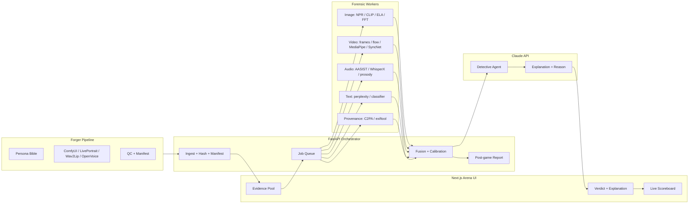

# Deepfake Arena — Research Dossier

> Problem statement #3: **Deepfake Arena: Red Team vs Blue Team**
> Purpose: reference material for building the Forger (Red) and Detective (Blue) with **Claude Code**.
> Compiled **27 Oct 2026** from the GitHub API, Hugging Face API, and **Context7** library docs.
> Star/download counts are point-in-time and move fast — treat them as a signal, not a spec.

---

## 0. How to use this file with Claude Code

Drop this file in the repo root, then start sessions with:

```text
@DEEPFAKE_ARENA_RESEARCH.md
```

Suggested split so Claude Code does not drown in context:

| Session | Give it | Ask for |
|---|---|---|
| Forger | §4 + §6 + §7 | generation pipeline, persona consistency, QC |
| Detective — image | §5.2 + §5.7 + §9 | detector ensemble + calibration |
| Detective — audio/video | §5.3, §5.4 + §7 | frame/audio feature extraction |
| Explanation UI | §5.8 + §8 + §10 | verdict cards, heatmaps, reason text |
| Content video | §11 + §12 | 45–90s 9:16 script + shot list |
| Rules audit | §11 + §13 | compliance checklist |

Do **not** paste the whole file into every subagent. Give each one its section.

---

## 1. The game, decoded

### Scoring (from the PDF)

| Event | Points |
|---|---:|
| Your fake fools another team | **+10 per team** |
| Detective catches a fake | **+5** |
| Correctly identifies a real item | **+3** |
| Correct reason | **+3** |
| False alarm on a real item | **−5** |
| Missed fake | **−3** |

With 4–5 teams, one good fake can be worth **+40 to +50**. One lazy false-alarm habit can erase several catches.

### The decision threshold (important)

Let `p = P(item is fake)`.

- Call **fake**: `EV = 8p − 5(1−p) = 13p − 5`
- Call **real**: `EV = 6(1−p) − 3p = 6 − 9p`

They break even at `p = 0.5`. If the “correct reason” bonus is only awarded on fakes, the break-even moves to `p ≈ 0.42`; if only on real items, it moves to `p ≈ 0.58`.

**Practical rule:** calibrate probabilities, then call the side above ~0.5. Do not use raw model softmax — deepfake detectors are badly overconfident on out-of-distribution data.

### Reason scoring changes the product

A verdict alone is not enough. The Detective must output a **method attribution** that matches what the Red team actually did. If the fake is a lip-sync job, “the face boundary is blurry” may be true but may not earn the reason point. Build a reason taxonomy that mirrors the forgery methods (see §9).

---

## 2. The single most important architecture decision

**Claude is the reasoning and explanation layer — not the detector and not the generator.**

What the Claude API accepts (verified via Context7, `platform.claude.com/docs`):

- **Text**
- **Images** — base64, URL, or uploaded file ID
- **PDFs** — via the Files API
- Tool use, structured JSON output, prompt caching, batch, MCP connector

What it does **not** natively accept as a message block:

- **Audio**
- **Video**

So the pipeline must convert media into things Claude can reason over:

```text
video  -> sampled frames (images) + transcript (text) + lip-sync metrics (JSON)
audio  -> waveform/spectrogram image + transcript + prosody features (JSON)
image  -> image + frequency/ELA/noise maps (images) + detector scores (JSON)
text   -> text + perplexity/burstiness features (JSON)
```

Then Claude does what it is genuinely good at:

1. **Orchestration** — decide which forensic tools to run.
2. **Cross-modal reasoning** — “the audio says /p/ but the lips show /b/”.
3. **Explanation** — turn signal JSON into a human-readable reason a non-expert understands.
4. **Report writing** — post-game report, per-item reasoning, confidence language.
5. **Content video** — script, storyboard, captions, AI voiceover copy.

It should **never** be the only classifier deciding real/fake. Vision models are not forensic instruments; they miss compression artifacts, frequency traces, and audio splicing.

---

## 3. Claude / Anthropic stack

### 3.1 Repos worth cloning or reading

| Repo | ★ | Why it matters here |
|---|---:|---|
| [`anthropics/claude-code`](https://github.com/anthropics/claude-code) | 153k | The agentic coding tool you are building with |
| [`anthropics/skills`](https://github.com/anthropics/skills) | 184k | Official Agent Skills; copy the `SKILL.md` structure for your own forensic skills |
| [`anthropics/claude-cookbooks`](https://github.com/anthropics/claude-cookbooks) | 54k | Runnable notebooks for vision, tool use, structured outputs, caching |
| [`anthropics/claude-agent-sdk-python`](https://github.com/anthropics/claude-agent-sdk-python) | 8.4k | Python agents; `@tool`, `query()`, hooks, MCP |
| [`modelcontextprotocol/servers`](https://github.com/modelcontextprotocol/servers) | 91.6k | Reference MCP servers (filesystem, git, fetch, memory, etc.) |
| [`modelcontextprotocol/python-sdk`](https://github.com/modelcontextprotocol/python-sdk) | 24.7k | Build your own forensic MCP server |
| [`modelcontextprotocol/inspector`](https://github.com/modelcontextprotocol/inspector) | 11.2k | Debug your MCP tools |
| [`modelcontextprotocol/registry`](https://github.com/modelcontextprotocol/registry) | 7.4k | Discover existing MCP servers |
| [`hesreallyhim/awesome-claude-code`](https://github.com/hesreallyhim/awesome-claude-code) | 56.6k | Curated Claude Code workflows, hooks, commands |
| [`ComposioHQ/awesome-claude-skills`](https://github.com/ComposioHQ/awesome-claude-skills) | 78k | Skills catalog |
| [`VoltAgent/awesome-claude-code-subagents`](https://github.com/VoltAgent/awesome-claude-code-subagents) | 26k | 100+ subagent patterns |
| [`upstash/context7`](https://github.com/upstash/context7) | — | Docs MCP server — the one used to verify this dossier |

### 3.2 Claude API features that matter for this build

| Feature | What Context7 says | How to use it |
|---|---|---|
| **Vision** | `image` content block with `source.type = base64 \| url \| file`; media types jpeg/png/gif/webp | Send sampled video frames, spectrograms, ELA/FFT maps |
| **Structured outputs** | `output_config.format = { type: "json_schema", schema: {...} }` | Force the verdict schema (§9) — no parsing roulette |
| **Tool use** | Standard Messages API tools | Let Claude call `run_image_detector`, `check_lipsync`, `read_c2pa` |
| **Files API** | `POST /v1/files`; reference by `file_id` | Upload large frame batches once, reuse across the pool |
| **Batch API** | `message-batches-2024-09-24` | Analyze the whole evidence pool overnight/offline |
| **Prompt caching** | `prompt-caching-2024-07-31`, 1h/5m TTL | Cache rules + reason taxonomy + persona bible across items |
| **Skills beta** | `skills-2025-10-02` | Package forensic procedures as reusable skills |
| **MCP connector** | `mcp-client-2025-04-04` / `2025-11-20` | Connect Claude directly to your forensic MCP server |
| **Managed agents** | `managed-agents-2026-04-01` (beta) | Optional: host the Detective loop without your own orchestration |

### 3.3 Minimal structured-verdict call

```python
import anthropic, json

client = anthropic.Anthropic()

VERDICT_SCHEMA = {
    "type": "object",
    "properties": {
        "item_id": {"type": "string"},
        "verdict": {"type": "string", "enum": ["fake", "real"]},
        "confidence": {"type": "number", "minimum": 0, "maximum": 1},
        "reason_code": {"type": "string"},
        "reason_text": {"type": "string"},
        "signals_used": {"type": "array", "items": {"type": "string"}},
    },
    "required": ["item_id", "verdict", "confidence", "reason_code", "reason_text", "signals_used"],
    "additionalProperties": False,
}

resp = client.messages.create(
    model="<current Sonnet/Opus model id>",
    max_tokens=1200,
    system="You are a forensic analyst. Only use the supplied signals. Never invent evidence.",
    messages=[{
        "role": "user",
        "content": [
            {"type": "image", "source": {"type": "base64", "media_type": "image/jpeg", "data": frame_b64}},
            {"type": "text", "text": json.dumps(signal_bundle)},
            {"type": "text", "text": "Return a verdict and a reason grounded in the signals."},
        ],
    }],
    output_config={"format": {"type": "json_schema", "schema": VERDICT_SCHEMA}},
)
print(resp.content[0].text)
```

> Model IDs and beta headers change. Ask Claude Code to read the current `platform.claude.com/docs` page before wiring this.

### 3.4 Agent SDK pattern

Context7 confirms the Python SDK exposes:

- `@tool("name", "description", {schema})` for custom tools
- `query(prompt=..., options=...)` for a one-shot agent run
- Hooks such as `SubagentStop` for logging
- `mcpServers` + `allowedTools` for scoped tool permissions

That maps cleanly to a **Detective agent** with tools:

```text
run_image_forensics(path)
run_audio_forensics(path)
run_video_temporal_forensics(path)
check_lipsync(video, audio)
read_provenance(path)
lookup_reason_code(code)
```

Keep the agent’s tools **read-only** and sandboxed. The Detective should never have write/upload tools.

---

## 4. Red team — Forger stack

### 4.1 Generation repos

| Repo | ★ | Role | Notes |
|---|---:|---|---|
| [`Comfy-Org/ComfyUI`](https://github.com/Comfy-Org/ComfyUI) | 143k | Image generation backend | Graph/API workflow; `POST /prompt` + websocket events (verified via Context7) |
| [`facefusion/facefusion`](https://github.com/facefusion/facefusion) | 30.4k | Face swap + enhancement | CLI and UI; fast |
| [`hacksider/Deep-Live-Cam`](https://github.com/hacksider/Deep-Live-Cam) | 97.3k | One-image real-time face swap | Good for quick stills/video; review license |
| [`iperov/DeepFaceLab`](https://github.com/iperov/DeepFaceLab) | 19.3k | Classic deepfake training | **Archived**; heavy; avoid for a 48h build |
| [`KlingAIResearch/LivePortrait`](https://github.com/KlingAIResearch/LivePortrait) | 19.3k | Animate a still portrait | Strong for talking-head clips; pipeline verified via Context7 |
| [`OpenTalker/SadTalker`](https://github.com/OpenTalker/SadTalker) | 14.2k | Audio-driven talking head | Older but reliable; 256px-ish output |
| [`Rudrabha/Wav2Lip`](https://github.com/Rudrabha/Wav2Lip) | 13.3k | Lip-sync any face to audio | CLI: `python inference.py --checkpoint_path <ckpt> --face <video> --audio <audio>` |
| [`deepinsight/insightface`](https://github.com/deepinsight/insightface) | 30.1k | Face detect/align/swap (`inswapper`) | Also useful to the Blue team |
| [`google-ai-edge/mediapipe`](https://github.com/google-ai-edge/mediapipe) | 37.4k | 478 landmarks + 52 blendshapes | Cheap facial-motion signal for both sides |
| [`laiyingxin2/Agent4FaceForgery`](https://github.com/laiyingxin2/Agent4FaceForgery) | 208 | Multi-agent LLM face-forgery framework | Read this for orchestration ideas |
| [`myshell-ai/OpenVoice`](https://github.com/myshell-ai/OpenVoice) | 38.1k | Instant voice cloning / TTS | Synthetic voice design |
| [`coqui-ai/TTS`](https://github.com/coqui-ai/TTS) | 46.2k | TTS toolkit | Great locally; project maintenance is slow |
| [`fishaudio/fish-speech`](https://github.com/fishaudio/fish-speech) | 33.4k | SOTA open TTS | Multilingual; check VRAM |
| [`microsoft/VibeVoice`](https://github.com/microsoft/VibeVoice) | 55k | Frontier voice AI | Newer; verify license and Hindi support |
| [`SparkAudio/Spark-TTS`](https://github.com/SparkAudio/Spark-TTS) | 11k | TTS | Lightweight alternative |

Hosted fallbacks if GPUs are the bottleneck: **Replicate**, **fal.ai**, **ElevenLabs** (voice design, not cloning a real person).

### 4.2 The persona problem

The rules say **“using only the provided synthetic personas.”** Two scenarios:

1. **Organizers provide a persona pack** (face images + voice samples + bios) → build around it; consistency is mostly solved.
2. **You must create personas** → generate them once, then keep an asset bible:

```text
personas/persona_01/
  identity.json        # name, age, city, job, backstory (fictional)
  face/                # 5–10 consistent stills, different angles/lighting
  voice/               # 30–60s reference + TTS preset
  wardrobe/            # consistent clothing/props
  consent.txt          # "synthetic persona, no real person"
```

**Consistency is the Red team’s real weapon.** A fake that is visually convincing but has a different ear shape, hairline, or voice timbre across items is easy to cluster and flag.

### 4.3 Five-item portfolio (maximise coverage)

A balanced portfolio attacks different Detective weaknesses:

| Item | Attack surface | Why |
|---|---|---|
| 1 × still image | frequency/diffusion detectors | Cheapest to make; tests image pipeline |
| 1 × short video (5–10s) | temporal + lip-sync + frame detectors | Highest points, highest effort |
| 1 × audio clip | anti-spoofing + prosody | Often the weakest Blue modality |
| 1 × text post | perplexity/burstiness detectors | Cheap; tests the text path |
| 1 × cross-modal item | audio+video or image+caption inconsistency | Hardest to catch; best chance to fool multiple teams |

Do **not** submit five variants of the same method. One detector gap can catch all five.

### 4.4 Forger QC checklist

Before an item enters the pool:

- [ ] Face identity matches the persona bible (ears, hairline, moles, teeth)
- [ ] Lip-sync phoneme/viseme alignment checked at 0.5× speed
- [ ] No frame warping around jaw/neck/hairline
- [ ] Lighting and shadows consistent with background
- [ ] Hands, glasses, jewelry, text in background checked
- [ ] Audio: breaths, pauses, room tone, prosody; no robotic cadence
- [ ] Container metadata stripped of accidental real-person data
- [ ] Internal manifest records method, persona, intended tell (never shipped to organizers)
- [ ] File plays on a clean machine without codec surprises

---

## 5. Blue team — Detective stack

### 5.1 Benchmarks and indexes (read these first)

| Resource | What it gives you |
|---|---|
| [`SCLBD/DeepfakeBench`](https://github.com/SCLBD/DeepfakeBench) ★1.1k | **36 detectors** (28 image, 8 video), 9 datasets, standardized AUC/EER/AP protocols; DeepfakeBench-v2 includes Effort (ICML’25), LSDA (CVPR’24), AltFreezing (CVPR’23) |
| [`Daisy-Zhang/Awesome-Deepfakes-Detection`](https://github.com/Daisy-Zhang/Awesome-Deepfakes-Detection) ★1.8k | Papers + code index |
| [`flyingby/Awesome-Deepfake-Generation-and-Detection`](https://github.com/flyingby/Awesome-Deepfake-Generation-and-Detection) ★652 | CSUR 2026 survey; generation + detection |
| [`qiqitao77/Awesome-Comprehensive-Deepfake-Detection`](https://github.com/qiqitao77/Awesome-Comprehensive-Deepfake-Detection) ★332 | Up-to-date comprehensive list |
| [`clpeng/Awesome-Face-Forgery-Generation-and-Detection`](https://github.com/clpeng/Awesome-Face-Forgery-Generation-and-Detection) ★783 | Face-specific |
| [`media-sec-lab/Audio-Deepfake-Detection`](https://github.com/media-sec-lab/Audio-Deepfake-Detection) ★326 | Audio datasets + papers |
| [`aerophile/awesome-deepfakes`](https://github.com/aerophile/awesome-deepfakes) ★1.7k | Tools + datasets |
| [`datamllab/awesome-deepfakes-materials`](https://github.com/datamllab/awesome-deepfakes-materials) ★444 | Datasets + tutorials |

### 5.2 Image detection

**Open-source detectors**

| Repo | ★ | Method |
|---|---:|---|
| [`chuangchuangtan/NPR-DeepfakeDetection`](https://github.com/chuangchuangtan/NPR-DeepfakeDetection) | 316 | Nearest-pixel reconstruction; strong generalisation, cheap |
| [`WisconsinAIVision/UniversalFakeDetect`](https://github.com/WisconsinAIVision/UniversalFakeDetect) | 379 | CLIP-based universal fake detection |
| [`grip-unina/ClipBased-SyntheticImageDetection`](https://github.com/grip-unina/ClipBased-SyntheticImageDetection) | 92 | CLIP synthetic-image detector |
| [`SCLBD/DeepfakeBench`](https://github.com/SCLBD/DeepfakeBench) | 1.1k | 28 image detectors in one framework |

**Hugging Face models** (downloads as of 27 Oct 2026 — not accuracy)

| Model | Downloads | Modality |
|---|---:|---|
| [`buildborderless/CommunityForensics-DeepfakeDet-ViT`](https://huggingface.co/buildborderless/CommunityForensics-DeepfakeDet-ViT) | 32.1k | image |
| [`prithivMLmods/AI-vs-Deepfake-vs-Real-Siglip2`](https://huggingface.co/prithivMLmods/AI-vs-Deepfake-vs-Real-Siglip2) | 8.1k | image |
| [`dima806/deepfake_vs_real_image_detection`](https://huggingface.co/dima806/deepfake_vs_real_image_detection) | 7.9k | image |
| [`prithivMLmods/Deep-Fake-Detector-v2-Model`](https://huggingface.co/prithivMLmods/Deep-Fake-Detector-v2-Model) | 6.1k | image |
| [`KoreaPeter/ms-eff-gcvit-deepfake-b0-ff-plus-plus`](https://huggingface.co/KoreaPeter/ms-eff-gcvit-deepfake-b0-ff-plus-plus) | 6.3k | video |
| [`KoreaPeter/ms-eff-gcvit-deepfake-b0-kodf`](https://huggingface.co/KoreaPeter/ms-eff-gcvit-deepfake-b0-kodf) | 6.0k | video |

**Classical forensics to run alongside neural nets**

- **ELA** (error level analysis) — JPEG re-compression inconsistencies.
- **FFT/DCT** — high-frequency grid artifacts from GAN/diffusion upsampling.
- **Noise residual / SRM filters** — sensor-noise inconsistency.
- **JPEG ghost** — double compression.
- **Color/lighting consistency** — face vs background.
- **Metadata sanity** — camera make/model, software tags, dimensions.

These are cheap, explainable, and give the reason text real substance. Use OpenCV + NumPy; no GPU needed.

### 5.3 Video detection

Video is where the points are, and where naive detectors fail.

**Signals**

| Signal | Tool | What it catches |
|---|---|---|
| Per-frame detector scores | image detector + `ffmpeg` sampling | diffusion/GAN frames |
| Temporal flicker | frame-to-frame score variance | inconsistent generation |
| Optical flow discontinuity | OpenCV Farneback / RAFT | face/background warping |
| Face landmarks + blendshapes | MediaPipe (478 pts, 52 blendshapes) | unnatural expression |
| Lip-sync | [`joonson/syncnet_python`](https://github.com/joonson/syncnet_python) ★917 | audio-visual mismatch |
| Head pose stability | MediaPipe / InsightFace | frozen or jittery pose |
| Blink rate | landmarks | too few/too many blinks |
| Compression history | `ffprobe`, `exiftool` | re-encoding, edits |

**Practical recipe**

```text
1. ffmpeg -i item.mp4 -r 2 frames/%04d.jpg        # 2 fps is enough for most clips
2. run image detector on each frame
3. compute temporal variance + optical flow
4. run MediaPipe landmarks/blendshapes on face crops
5. run SyncNet on the audio track
6. send score timeline + flagged frames to Claude
```

### 5.4 Audio detection

| Resource | Why |
|---|---|
| [`clovaai/aasist`](https://github.com/clovaai/aasist) ★308 | Canonical audio anti-spoofing model (AASIST) |
| [`s3prl/s3prl`](https://github.com/s3prl/s3prl) ★2.6k | Self-supervised speech representations; strong features |
| [`SYSTRAN/faster-whisper`](https://github.com/SYSTRAN/faster-whisper) ★26.2k | Transcript + **word-level timestamps** (`word_timestamps=True`) |
| [`m-bain/whisperX`](https://github.com/m-bain/whisperX) ★24.9k | Word alignment + diarization |
| [`media-sec-lab/Audio-Deepfake-Detection`](https://github.com/media-sec-lab/Audio-Deepfake-Detection) | Datasets + SOTA index |

**HF models**

| Model | Downloads |
|---|---:|
| [`mo-thecreator/Deepfake-audio-detection`](https://huggingface.co/mo-thecreator/Deepfake-audio-detection) | 21.3k |
| [`Hemgg/Deepfake-audio-detection`](https://huggingface.co/Hemgg/Deepfake-audio-detection) | 12.9k |
| [`Gustking/wav2vec2-large-xlsr-deepfake-audio-classification`](https://huggingface.co/Gustking/wav2vec2-large-xlsr-deepfake-audio-classification) | 11.3k |
| [`garystafford/wav2vec2-deepfake-voice-detector`](https://huggingface.co/garystafford/wav2vec2-deepfake-voice-detector) | 9.0k |
| [`MelodyMachine/Deepfake-audio-detection-V2`](https://huggingface.co/MelodyMachine/Deepfake-audio-detection-V2) | 6.5k |

**Audio signals beyond the classifier**

- Spectrogram holes / banding (TTS vocoder artifacts)
- Unnaturally stable pitch; missing micro-prosody
- Breath and pause distribution
- Room-tone continuity across cuts
- Speaker-embedding consistency (same persona across clips)
- Transcript vs lip-sync alignment

### 5.5 Text detection

Text is the cheapest item and often the weakest link in a Detective.

- **Perplexity / burstiness** with a small local LM (GPT-2 class) — cheap, explainable.
- **Classifier models** — search HF for `ai-text-detection`, `chatgpt-detector`; benchmark before trusting.
- **LLM judge** — Claude with a rubric (“does this read like a press release, a bot, a persona?”). Do not use as sole evidence.
- **Cross-modal consistency** — does the text describe the same persona, city, job as the image/audio?
- **Factual checks** — dates, places, public claims. Fabricated specifics are a strong tell.

### 5.6 Provenance and metadata

| Tool | What it does |
|---|---|
| [`contentauth/c2pa-python`](https://github.com/contentauth/c2pa-python) ★109 | Read/verify/create signed Content Credentials; `c2pa.Reader(...).json()` |
| [`exiftool/exiftool`](https://github.com/exiftool/exiftool) ★5.2k | EXIF/XMP/container metadata |
| `ffprobe` | Codec, bitrate, duration, encoder tags |

Context7 confirms the C2PA Python flow:

```python
builder = c2pa.Builder(manifest_definition)
builder.sign(signer, "image/jpeg", src, dst)

reader = c2pa.Reader("image/jpeg", file)
print(reader.json())
```

**Caution:** most social/messaging pipelines strip metadata. Absence of C2PA is **not** proof of a fake. Use provenance as one weak signal, never as the verdict.

### 5.7 Fusion and calibration

Do not average raw softmax scores. Build a small feature vector and calibrate:

```text
features = [
  image_detector_score,
  frequency_artifact_score,
  ela_score,
  face_boundary_score,
  lipsync_score,
  temporal_variance,
  audio_spoof_score,
  prosody_score,
  text_perplexity_z,
  metadata_flags,
  cross_modal_consistency,
]
```

- Fit **logistic regression** or **gradient boosting** on your own labelled mini-set (your Forger can generate the fakes; use public real images/audio for the real class).
- Use **temperature scaling / isotonic regression** for calibration (scikit-learn).
- Report `confidence` as calibrated probability, not raw model output.
- Add a **reason code** per contributing signal so the explanation is traceable.

### 5.8 Explanation view

The rules require “highlight what triggered suspicion so a non-expert can understand.”

| Modality | View |
|---|---|
| Image | Original vs ELA/FFT heatmap; detector attention (Grad-CAM); metadata panel; flagged regions |
| Video | Frame strip + per-frame score timeline; flagged frames; lip-sync alignment plot; optical-flow map |
| Audio | Spectrogram with highlighted bands; waveform; transcript with word timestamps; spoof score |
| Text | Sentence highlighting; perplexity curve; style/fact flags |
| All | Verdict badge, calibrated confidence, reason code, 2–4 sentence plain-language explanation, “what would change my mind” |

Claude turns the signal JSON into the 2–4 sentence explanation. Keep the underlying evidence visible so the judge can audit it.

---

## 6. Datasets and archives

> Rules: **synthetic or public data only.** Most research datasets are research-licence only — use them for calibration/validation, do not redistribute or ship them inside the product.

### 6.1 Video / image

| Dataset | Modality | Link / notes |
|---|---|---|
| **FaceForensics++** | video | [`ondyari/FaceForensics`](https://github.com/ondyari/FaceForensics); the standard benchmark |
| **DFDC** | video | [Kaggle Deepfake Detection Challenge](https://www.kaggle.com/c/deepfake-detection-challenge); large, diverse |
| **Celeb-DF** | video | [`yuezunli/celeb-deepfakeforensics`](https://github.com/yuezunli/celeb-deepfakeforensics) ★336 |
| **DeeperForensics-1.0** | video | [`liming-ai/DeeperForensics-1.0`](https://github.com/liming-ai/DeeperForensics-1.0) |
| **OpenForensics** | image | [`sunnytqin/OpenForensics`](https://github.com/sunnytqin/OpenForensics) |
| **DeepfakeBench** | mixed | 9 datasets wrapped with standard splits — best starting point |
| **GenImage** | image | [`Andrew-Zhu/GenImage`](https://github.com/Andrew-Zhu/GenImage); million-scale AI-generated vs real |
| **CIFAKE** | image | [Kaggle CIFAKE](https://www.kaggle.com/datasets/birdy654/cifake-real-and-ai-generated-synthetic-images) |
| **AV-Deepfake1M** | audio+video | [`ControlNet/AV-Deepfake1M`](https://huggingface.co/datasets/ControlNet/AV-Deepfake1M) (HF, 1.6k downloads) |
| **DeepFakeFace** | image | [`OpenRL/DeepFakeFace`](https://huggingface.co/datasets/OpenRL/DeepFakeFace) (HF, 7.9k downloads) |

### 6.2 Audio

| Dataset | Link / notes |
|---|---|
| **ASVspoof 2019 / 2021 / 5** | [asvspoof.org](https://www.asvspoof.org/); [`asvspoof-challenge/asvspoof5`](https://github.com/asvspoof-challenge/asvspoof5) ★79 |
| **WaveFake** | [`RUB-SysSec/WaveFake`](https://github.com/RUB-SysSec/WaveFake); vocoder-generated fakes |
| **BRSpeech-DF** | [`AKCIT-Deepfake/BRSpeech-DF`](https://huggingface.co/datasets/AKCIT-Deepfake/BRSpeech-DF) (HF, 1.5k downloads) |
| **deepfake-audio-detection** | [`garystafford/deepfake-audio-detection`](https://huggingface.co/datasets/garystafford/deepfake-audio-detection) (HF, 1.3k downloads) |

### 6.3 Text

| Resource | Notes |
|---|---|
| **HC3 / ChatGPT detector datasets** | Search HF `ai-text-detection`; many are noisy |
| **Your own generated corpus** | Best option: have Claude write persona-consistent posts, label them, mix with real public posts |

### 6.4 Benchmarks / papers to cite

- **DeepfakeBench-v2** — 36 detectors, 9 datasets, AUC/EER/AP. Start here.
- **Deepfake-Eval-2024** — in-the-wild 2024 deepfakes; useful for realism, verify current dataset link.
- **NTIRE Robust AIGenDetection** — [`deepfakesMSU/NTIRE-RobustAIGenDetection-train`](https://huggingface.co/datasets/deepfakesMSU/NTIRE-RobustAIGenDetection-train) (HF, 1k downloads).
- **CSUR 2026 survey** — `flyingby/Awesome-Deepfake-Generation-and-Detection`.

---

## 7. Claude Code workspace setup

### 7.1 `CLAUDE.md` (template)

```markdown
# Deepfake Arena — project rules

## Mission
Build a Forger (Red) and Detective (Blue) for a synthetic-media game.
All media is synthetic. No real people.

## Hard rules
- Never use real politicians, celebrities, officials, classmates, or private individuals.
- Never upload generated fakes to social media, messaging apps, or public URLs.
- Never add real personal data to prompts, datasets, or commits.
- The Detective is read-only: no upload, no external posting, no deletion.
- Every verdict must cite the signals it used. No invented evidence.
- Label AI-generated parts in the content video.

## Stack
- Next.js + Tailwind for the arena UI
- FastAPI + Python workers for forensics
- SQLite/Postgres + local object storage
- Claude API for orchestration/explanation (structured outputs)
- ComfyUI / LivePortrait / Wav2Lip / OpenVoice for generation

## Commands
- `make dev` / `make test` / `make eval`
- `python -m forger.generate --persona ...`
- `python -m detective.analyze --item ...`

## Scoring policy
- Calibrated p(fake); call fake above ~0.5.
- Reason code must name the method (lip-sync, face swap, TTS, diffusion, text).
- Prefer "uncertain" language over a false confident claim.

## Don'ts
- Don't tune only on your own fakes.
- Don't trust one detector.
- Don't strip the audit log.
```

### 7.2 Subagents

| Agent | Tools | Job |
|---|---|---|
| `forger-image` | ComfyUI API, Read/Write | persona-consistent stills |
| `forger-video` | LivePortrait/Wav2Lip, ffmpeg | talking-head clips |
| `forger-audio` | OpenVoice/Fish Speech | synthetic voice |
| `detective-image` | Python, HF models, OpenCV | image signals |
| `detective-video` | ffmpeg, MediaPipe, SyncNet | temporal + lip-sync |
| `detective-audio` | AASIST, WhisperX | audio spoof + transcript |
| `fusion-calibrator` | scikit-learn | probability calibration |
| `explainer-ui` | Next.js, Claude API | verdict cards |
| `rules-auditor` | Read, Grep | compliance scan |
| `content-video` | ffmpeg, Claude | 45–90s 9:16 reel |

Context7 confirms subagent frontmatter fields include `name`, `description`, `prompt`, `tools`, `skills`, `memory`, `model`, `effort`, and `omitClaudeMd`.

### 7.3 Skills

Create `.claude/skills/` with focused `SKILL.md` files:

```text
.claude/skills/
  deepfake-forensics/SKILL.md   # signal extraction checklist
  c2pa/SKILL.md                 # verify/sign manifests
  ffmpeg/SKILL.md               # frame/audio extraction recipes
  comfyui/SKILL.md              # workflow JSON + API
  model-eval/SKILL.md           # AUC/EER/calibration protocol
  reason-codes/SKILL.md         # taxonomy + examples
```

Keep each skill under ~200 lines. Skills are loaded on demand; do not make one giant skill.

### 7.4 MCP servers

| Server | Use |
|---|---|
| `context7` | current docs for Claude API, transformers, ffmpeg |
| `filesystem` | local media/data access (scoped) |
| `playwright` | test the arena UI and demo flow |
| `github` | issues/PRs if you use a remote repo |
| `fetch` | public dataset/model pages (read-only) |

Add a **custom forensic MCP server** exposing the tools in §3.4. That keeps the Detective agent’s tool surface small and auditable.

### 7.5 Hooks

| Hook | Action |
|---|---|
| `PreToolUse` on Bash/network | block `curl`/`scp`/uploads of generated media |
| `PreToolUse` on Write | block paths containing `real_people/`, `private/` |
| `PostToolUse` | run `ruff`, `pytest`, `npm test` |
| `SubagentStop` | append verdict + signals to `audit/verdicts.jsonl` |
| `Stop` | remind to label AI content in the video |

### 7.6 Parallel work

Use git worktrees for `forger`, `detective`, `ui`, `video` so agents do not overwrite each other. Merge through a human-reviewed PR. Avoid letting two agents edit the same `CLAUDE.md`.

---

## 8. Reference architecture



Suggested storage:

```text
data/
  pool/{item_id}/original.*      # immutable
  pool/{item_id}/frames/
  pool/{item_id}/audio.wav
  pool/{item_id}/signals.json
  pool/{item_id}/verdict.json
  audit/verdicts.jsonl
  personas/{persona_id}/
```

Hash every item on ingest (`sha256`). Never mutate the original — all analysis writes to sibling files.

---

## 9. Decision policy, schema, and reason taxonomy

### 9.1 Verdict schema

```json
{
  "item_id": "itm_01H...",
  "verdict": "fake",
  "confidence": 0.78,
  "reason_code": "LIPSYNC_MISMATCH",
  "reason_text": "The /p/ and /b/ phonemes at 00:03 and 00:07 do not match the visible lip closure; the lower lip moves before the audio onset.",
  "signals_used": ["lipsync_score=0.91", "frame_score_mean=0.64", "audio_spoof=0.72"],
  "evidence_refs": ["signals.json#/video/lipsync", "frames/0042.jpg"]
}
```

### 9.2 Reason codes (align with likely attacks)

| Code | Meaning |
|---|---|
| `DIFFUSION_ARTIFACT` | high-frequency/grid traces, over-smooth texture |
| `FACE_SWAP_BOUNDARY` | jaw/hairline/ear blending, lighting mismatch |
| `LIPSYNC_MISMATCH` | phoneme/viseme drift, audio-visual offset |
| `TEMPORAL_FLICKER` | frame-to-frame identity/texture instability |
| `TTS_ARTIFACT` | vocoder banding, unnatural prosody/breaths |
| `VOICE_CLONE_MISMATCH` | speaker embedding inconsistent with persona |
| `TEXT_AI_STYLE` | perplexity/burstiness + generic phrasing |
| `CROSS_MODAL_CONFLICT` | audio/image/text disagree on identity or facts |
| `PROVENANCE_ANOMALY` | metadata/C2PA inconsistent (weak signal) |
| `NO_STRONG_SIGNAL` | real / insufficient evidence |

The reason text should name **what** was found, **where**, and **why it is unusual** — plus an innocent explanation when one exists. The rules explicitly ask for that.

### 9.3 Confidence language

| Calibrated p | Wording |
|---|---|
| 0.90–1.00 | “strong evidence” |
| 0.70–0.89 | “likely” |
| 0.50–0.69 | “leaning, but not certain” |
| 0.30–0.49 | “probably real; weak anomalies” |
| 0.00–0.29 | “no meaningful evidence of manipulation” |

Never say “fraud”, “criminal”, or name a person/party. The game is about media forensics, not accusations.

---

## 10. Content video (45–90s, 9:16)

The PDF requires:

- Hook in the first 5 seconds
- Behind-the-scenes of the team building
- Short demo of Forger + Detective
- AI used in the making (voiceover, visuals, captions, editing)
- 45–90 seconds, vertical 9:16
- AI-generated parts labelled

A structure that fits the scoring:

```text
0–5s    Hook: "This voice is fake. Can you tell?" (persona audio)
5–15s   Problem: fakes are cheap; detection is untested
15–30s  Red: show the Forger creating the persona/fake (BTS)
30–50s  Blue: Detective verdict + reason + explanation view
50–65s  Reveal + scoreboard; Red vs Blue rivalry
65–80s  BTS team + "made with AI" label + CTA
```

Claude can write the script, shot list, captions, and voiceover copy. Generate the voiceover with a synthetic voice; label it. Do **not** use a real person’s likeness or voice.

---

## 11. Rules and compliance guardrails

| Rule | Implementation |
|---|---|
| Synthetic personas only | persona registry with `synthetic: true`; blocklist real names |
| No real people | scan prompts/files for known public figures; human review |
| Fakes stay inside hackathon | no upload tools; network egress blocked in the worker container; no public URLs |
| Label AI in content video | burned-in “made with AI” + description |
| No consent issues | synthetic assets only; keep consent log |
| Reasoning + confidence on every output | schema requires `reason_text`, `signals_used`, `confidence` |
| Treat all sides equally | no political targeting; persona set is fictional and neutral |
| Human review | Red team member signs off before an item enters the pool |

**Important tension:** the pool fakes must be unlabeled to be game-legal, but the content video must label AI. Keep two separate pipelines:

- `pool/` — no provenance labels, internal manifest only, never published.
- `promo/` — labelled, safe to show.

---

## 12. If you only clone ten things

1. [`anthropics/claude-cookbooks`](https://github.com/anthropics/claude-cookbooks) — how to wire vision + structured outputs.
2. [`anthropics/skills`](https://github.com/anthropics/skills) — skill format.
3. [`SCLBD/DeepfakeBench`](https://github.com/SCLBD/DeepfakeBench) — detectors + evaluation.
4. [`Comfy-Org/ComfyUI`](https://github.com/Comfy-Org/ComfyUI) — image generation.
5. [`KlingAIResearch/LivePortrait`](https://github.com/KlingAIResearch/LivePortrait) — portrait animation.
6. [`Rudrabha/Wav2Lip`](https://github.com/Rudrabha/Wav2Lip) — lip-sync.
7. [`myshell-ai/OpenVoice`](https://github.com/myshell-ai/OpenVoice) — synthetic voice.
8. [`deepinsight/insightface`](https://github.com/deepinsight/insightface) — face detection/alignment.
9. [`joonson/syncnet_python`](https://github.com/joonson/syncnet_python) — lip-sync scoring.
10. [`contentauth/c2pa-python`](https://github.com/contentauth/c2pa-python) — provenance checks.

Add [`Daisy-Zhang/Awesome-Deepfakes-Detection`](https://github.com/Daisy-Zhang/Awesome-Deepfakes-Detection) as the index for everything else.

---

## 13. Open questions to resolve with the organizers

1. **Persona pack** — do they provide faces/voices, or do teams create them? What licence?
2. **Pool protocol** — are your own fakes excluded from your Detective’s pool? Is the pool blinded by hash only?
3. **Reason scoring** — is “correct reason” judged by method, artifact, or free text? Ask for examples.
4. **Compute** — GPU available on-site, or cloud only? Internet access for model downloads?
5. **API budget** — is Claude API usage allowed/paid? Any rate limits?
6. **Video specs** — max duration/resolution/file size for pool items.
7. **Content video** — is AI voiceover allowed? Any platform/length constraints beyond 9:16?
8. **Disqualifiers** — what exactly counts as “posting online”? Does a local demo URL count?

---

## Appendix A — Context7 sources used

| Library ID | Queried for |
|---|---|
| `/websites/platform_claude_en_api` | vision image blocks, structured outputs, batch/files, audio/video support |
| `/websites/code_claude_en_agent-sdk` | subagents, hooks, MCP permissions |
| `/anthropics/claude-agent-sdk-python` | `@tool`, `query()`, custom tools |
| `/anthropics/claude-code` | agent frontmatter, skills, subagents |
| `/sclbd/deepfakebench` | 36 detectors, 9 datasets, AUC/EER/AP |
| `/contentauth/c2pa-python` | sign/verify manifest |
| `/deepinsight/insightface` | face detection/landmarks |
| `/websites/developers_google_edge_mediapipe` | 478 landmarks, 52 blendshapes |
| `/rudrabha/wav2lip` | inference CLI |
| `/klingairesearch/liveportrait` | animate pipeline |
| `/websites/ffmpeg_ffmpeg-all` | frame extraction |
| `/systran/faster-whisper` | word timestamps |
| `/comfy-org/comfyui` | `POST /prompt` API |

## Appendix B — Data snapshot

- GitHub stars and Hugging Face download counts pulled **27 Oct 2026**.
- Claude API capabilities verified against `platform.claude.com/docs` through Context7 on the same date.
- Model IDs, beta headers, and library versions change — re-check before wiring production code.

---

*This is a research map, not a build plan. Use it to choose tools, then let Claude Code implement and benchmark the choices.*
